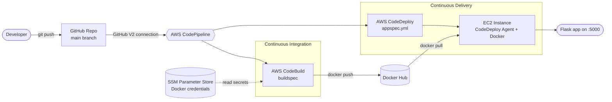

# AWS-CI-CD-Pipeline-CodePipeline-CodeBuild-CodeDeploy

**AWS CI/CD Pipeline: GitHub → CodePipeline → CodeBuild → CodeDeploy → EC2**

An end-to-end **Continuous Integration and Continuous Delivery** pipeline on AWS using managed services. A commit to the `main` branch automatically builds a Docker image, pushes it to Docker Hub, and deploys it as a running container on an EC2 instance, with no manual steps.

---

## Table of Contents

1. [Project Overview](#project-overview)
2. [Architecture](#architecture)
3. [Tech Stack](#tech-stack)
4. [Repository Structure](#repository-structure)
5. [Prerequisites](#prerequisites)
6. [Part 1: Continuous Integration (Day 14)](#part-1-continuous-integration-day-14)
7. [Part 2: Continuous Delivery (Day 15)](#part-2-continuous-delivery-day-15)
8. [Testing the Full Pipeline](#testing-the-full-pipeline)
9. [Troubleshooting Log](#troubleshooting-log)
10. [Security Notes](#security-notes)
11. [Known Limitations](#known-limitations)
12. [Future Improvements](#future-improvements)
13. [Cleanup](#cleanup)
14. [Key Learnings](#key-learnings)

---

## Project Overview

| Item | Details |
|---|---|
| **Goal** | Automate build, push, and deploy of a containerised Python Flask app |
| **Trigger** | Any commit pushed to the `main` branch on GitHub |
| **CI** | AWS CodeBuild builds the Docker image and pushes it to Docker Hub |
| **CD** | AWS CodeDeploy pulls the image and runs the container on EC2 |
| **Orchestrator** | AWS CodePipeline |
| **Secrets** | AWS Systems Manager Parameter Store (SecureString) |
| **Region** | `us-east-1` (N. Virginia) |

---

## Architecture



**Pipeline stages**

```
Source (GitHub) ──▶ Build (CodeBuild) ──▶ Deploy (CodeDeploy)
```

1. **Source:** GitHub (Version 2 connection) detects a commit and triggers the pipeline.
2. **Build:** CodeBuild checks out the code, builds the Docker image, and pushes it to Docker Hub.
3. **Deploy:** CodeDeploy runs the lifecycle hooks on the EC2 instance. The hooks stop the old container, pull the new image, and start a new container.

---

## Tech Stack

| Category | Tool |
|---|---|
| Source control | GitHub |
| Orchestration | AWS CodePipeline |
| Build (CI) | AWS CodeBuild |
| Deploy (CD) | AWS CodeDeploy |
| Compute | AWS EC2 (Ubuntu, t2.micro) |
| Secrets | AWS Systems Manager Parameter Store |
| Access control | AWS IAM roles |
| Container registry | Docker Hub |
| Application | Python 3.11, Flask |
| Containerisation | Docker |

---

## Repository Structure

> CodeDeploy requires `appspec.yml` to be at the **root** of a GitHub repository, so the layout below puts it there.

```
.
├── app.py                  # Flask application (Hello World)
├── requirements.txt        # Python dependencies (Flask)
├── Dockerfile              # Container image definition (exposes port 5000)
├── buildspec.yml           # CodeBuild specification (CI)
├── appspec.yml             # CodeDeploy specification (CD), must be at repo root
├── scripts/
│   ├── start_container.sh  # Pulls and runs the Docker image
│   └── stop_container.sh   # Stops/removes the running container
└── README.md
```
---

## Prerequisites

- An AWS account (use an **IAM user**, not root, for real work)
- A GitHub account and repository
- A Docker Hub account
- Basic familiarity with Git, Docker, and the AWS console
- A local terminal with SSH and an EC2 key pair (`.pem`)

---

## Part 1: Continuous Integration 
### 1.1 The Application

A minimal Flask app (the steps are identical for a more complex app).

**`requirements.txt`**
```
Flask
```

**`Dockerfile`**
```dockerfile
FROM python:3.11-slim
WORKDIR /app
COPY requirements.txt .
RUN pip install --no-cache-dir -r requirements.txt
COPY . .
EXPOSE 5000
CMD ["python", "app.py"]
```

> Adjust the `CMD` and the host binding to match your `app.py`. Inside a container, Flask must listen on `0.0.0.0` for the port mapping to work.

### 1.2 Store Docker Credentials in Parameter Store

Credentials must never be hard-coded in the buildspec. Create three parameters under **Systems Manager → Parameter Store → Create parameter**.

| Parameter name | Type | Value |
|---|---|---|
| `/myapp/docker-registry/url` | SecureString | `docker.io` |
| `/myapp/docker-credentials/username` | SecureString | `<your-dockerhub-username>` |
| `/myapp/docker-credentials/password` | SecureString | `<your-dockerhub-password-or-access-token>` |

- Tier: **Standard**
- Encryption: default KMS key
- Naming standard used: `/<application>/<credential-type>/<item>`. A consistent naming scheme saves confusion when you have hundreds of secrets.

> **Tip:** Use a Docker Hub **access token** instead of your account password.

### 1.3 Create the IAM Service Role for CodeBuild

CodeBuild is a service, not a person, so it uses an **IAM role** instead of an IAM user.

1. **IAM → Roles → Create role**
2. Trusted entity: **AWS service → CodeBuild**
3. Name it, for example, `codebuild-service-role`
4. Attach a policy that allows reading SSM parameters (the demo used `AmazonSSMFullAccess`; see [Security Notes](#security-notes) for the least-privilege version)

### 1.4 Create the CodeBuild Project

| Setting | Value |
|---|---|
| Project name | `sample-python-project` |
| Source provider | GitHub (connected via OAuth) |
| Repository | Your GitHub repository |
| Environment type | Managed image |
| Operating system | Ubuntu |
| Runtime | Standard |
| Image | Latest available |
| Environment type | Linux |
| **Privileged** | **Enabled** (required to run Docker inside the build) |
| Service role | Existing role from step 1.3 |
| Buildspec | Use `buildspec.yml` from the repository |

### 1.5 The Buildspec

**`buildspec.yml`**
```yaml
version: 0.2

env:
  parameter-store:
    DOCKER_REGISTRY_USERNAME: /myapp/docker-credentials/username
    DOCKER_REGISTRY_PASSWORD: /myapp/docker-credentials/password
    DOCKER_REGISTRY_URL: /myapp/docker-registry/url

phases:
  install:
    runtime-versions:
      python: 3.11

  pre_build:
    commands:
      - pip install -r requirements.txt

  build:
    commands:
      - echo "Building Docker image"
      - echo "$DOCKER_REGISTRY_PASSWORD" | docker login -u "$DOCKER_REGISTRY_USERNAME" --password-stdin "$DOCKER_REGISTRY_URL"
      - docker build -t "$DOCKER_REGISTRY_URL/$DOCKER_REGISTRY_USERNAME/simple-python-flask-app:latest" .
      - docker push "$DOCKER_REGISTRY_URL/$DOCKER_REGISTRY_USERNAME/simple-python-flask-app:latest"

  post_build:
    commands:
      - echo "Build is successful"
```

**How it works**

| Section | Purpose |
|---|---|
| `env.parameter-store` | Maps environment variables to the secrets in Parameter Store |
| `install.runtime-versions` | Selects the Python 3.11 runtime on the build image |
| `pre_build` | Installs dependencies |
| `build` | Logs in to Docker Hub, builds, tags, and pushes the image |
| `post_build` | Confirmation message (the deploy step is handled by CodeDeploy) |

> Source checkout is automatic because the GitHub repository is integrated as the project source.

### 1.6 Run the Build Manually

Click **Start build** to verify CodeBuild works before adding CodePipeline. Verify the image appears in Docker Hub under `<username>/simple-python-flask-app` with the tag `latest`.

### 1.7 Create the CodePipeline (CI)

1. **CodePipeline → Create pipeline**, name `sample-python-app`
2. Service role: **New service role**
3. Source provider: **GitHub (Version 2)**
   - Create a connection (**Connect to GitHub**) and authorise it
   - Select your repository and the `main` branch
4. Output artifact format: default
5. Build provider: **AWS CodeBuild** → select `sample-python-project` (Single build)
6. Skip the deploy stage for now
7. Review and **Create pipeline**

Result: **Source → Build**. Any push to `main` now builds and pushes a new image automatically.

---

## Part 2: Continuous Delivery 

### 2.1 Create the CodeDeploy Application

1. **CodeDeploy → Create application**
2. Name: `sample-python-flask-app`
3. Compute platform: **EC2/On-premises**

An application in CodeDeploy represents one microservice.

### 2.2 Launch the EC2 Instance

| Setting | Value |
|---|---|
| Name | `sample-python` |
| AMI | Ubuntu |
| Instance type | `t2.micro` |
| Key pair | Your existing key pair |
| Network | Default VPC, **auto-assign public IP enabled** |
| Security group | SSH (22) initially; port 5000 is opened later |
| **Tag** | `Name = sample-python` |

**Why the tag matters:** CodeDeploy identifies target instances by tag key-value pairs, not by name alone. Any instance carrying the same tag, including future ones, becomes a deployment target, so one deployment can reach 1, 10, or 100 instances.

### 2.3 Install the CodeDeploy Agent

SSH in and install the prerequisites and the agent. **Follow the official AWS documentation** for the exact bucket name for your region.

```bash
ssh -i <your-key>.pem ubuntu@<public-ip>

sudo apt update
sudo apt install ruby-full -y
sudo apt install wget -y

cd /home/ubuntu
wget https://<bucket-name>.s3.<region-identifier>.amazonaws.com/latest/install
chmod +x ./install
sudo ./install auto

sudo service codedeploy-agent status
sudo service codedeploy-agent start   # if it is not running
```

Install Docker on the instance (the deployment scripts depend on it):

```bash
sudo apt install docker.io -y
```

### 2.4 IAM Roles for CodeDeploy and EC2

EC2 and CodeDeploy must be able to talk to each other, so roles are used.

1. **IAM → Roles → Create role → AWS service → CodeDeploy**, name `ec2-codedeploy-role`
2. Attach `AmazonEC2FullAccess` (demo setup; see [Security Notes](#security-notes))
3. Attach the role to the instance: **EC2 → Instance → Actions → Security → Modify IAM role**
4. **Restart the agent** after any role change, otherwise the instance cannot communicate with CodeDeploy:

```bash
sudo service codedeploy-agent restart
sudo service codedeploy-agent status
```

> The demo used a single role for both purposes for simplicity. You can use two separate roles (a CodeDeploy service role and an EC2 instance profile).

### 2.5 Create the Deployment Group

The deployment group tells CodeDeploy **where** to deploy.

| Setting | Value |
|---|---|
| Name | `sample-python-app` |
| Service role | `ec2-codedeploy-role` |
| Deployment type | **In-place** |
| Environment configuration | Amazon EC2 instances, tag `Name = sample-python` |
| Load balancer | Disabled |

The console shows **1 unique matched instance** when the tag matches correctly.

### 2.6 The AppSpec File

**`appspec.yml`** (must be at the **repository root** and named exactly this):

```yaml
version: 0.0
os: linux
hooks:
  ApplicationStop:
    - location: scripts/stop_container.sh
      timeout: 300
      runas: root
  AfterInstall:
    - location: scripts/start_container.sh
      timeout: 300
      runas: root
```

| Hook | Script | Purpose |
|---|---|---|
| `ApplicationStop` | `stop_container.sh` | Remove the old container before the new one starts |
| `AfterInstall` | `start_container.sh` | Pull the latest image and run the container |

### 2.7 Deployment Scripts

**`scripts/start_container.sh`**
```bash
#!/bin/bash
docker pull <dockerhub-username>/simple-python-flask-app:latest
docker run -d --name simple-python-app -p 5000:5000 <dockerhub-username>/simple-python-flask-app:latest
```

**`scripts/stop_container.sh`**

The course version finds the first container ID with `docker ps | awk`. A more robust version stops the container by **name**, so it never touches unrelated containers and does not fail on the first deployment:

```bash
#!/bin/bash
docker rm -f simple-python-app 2>/dev/null || true
```

Make the scripts executable before committing:

```bash
chmod +x scripts/*.sh
```

> **Important:** The tag used when **pushing** (CI) must match the tag used when **pulling** (CD). Both use `latest` here.

### 2.8 Test CodeDeploy on Its Own

Before integrating with CodePipeline, create a manual deployment:

1. **Application → Deployments → Create deployment**
2. Deployment group: `sample-python-app`
3. Revision type: **GitHub**
4. Repository: `<github-user>/<repo-name>` and the latest **commit ID**
5. Create, then use **View events** to inspect each lifecycle step

### 2.9 Add the Deploy Stage to CodePipeline

1. **CodePipeline → your pipeline → Edit**
2. **Add stage**, name it `CodeDeploy`
3. **Add action group**
   - Action provider: **AWS CodeDeploy**
   - Input artifact: build or source artifact
   - Application name: `sample-python-flask-app`
   - Deployment group: `sample-python-app`
4. **Done → Save**

Final pipeline:

```
Source (GitHub) ──▶ Build (CodeBuild) ──▶ Deploy (CodeDeploy)
```

### 2.10 Open the Application Port

Add an inbound rule to the instance security group:

| Type | Protocol | Port | Source |
|---|---|---|---|
| Custom TCP | TCP | 5000 | Your IP (recommended), or `0.0.0.0/0` for a quick test |

Browse to `http://<ec2-public-ip>:5000`.

---

## Testing the Full Pipeline

1. Make a small change (for example, edit a line in `app.py`) and push to `main`:
   ```bash
   git add .
   git commit -m "test: trigger pipeline"
   git push origin main
   ```
2. In **CodePipeline**, watch **Source → Build → Deploy** run in order.
3. In **Docker Hub**, confirm the `latest` tag was updated.
4. On the EC2 instance, confirm the container is running:
   ```bash
   sudo docker ps
   ```
5. Open `http://<ec2-public-ip>:5000` and confirm the change is live.

If a stage fails, use **View events** (CodeDeploy) or the build logs (CodeBuild) to find the exact failing step. The pipeline can be re-run with **Release change**.

---

## Troubleshooting Log

### CodeBuild (Day 14)

| # | Error | Cause | Fix |
|---|---|---|---|
| 1 | Build cannot read Docker credentials | The CodeBuild service role had no access to Systems Manager | Attach an SSM read policy to the CodeBuild role |
| 2 | `No such file or directory: requirements.txt` | Path typo (`sample-python-app` vs `simple-python-app`) | Make buildspec paths match the repo folder names |
| 3 | `docker build requires exactly one argument` | Missing trailing `.` in `docker build -t ... .` | Add the build context `.` |
| 4 | `Cannot connect to the Docker daemon` | CodeBuild does not allow Docker builds by default | Enable **Privileged** mode in the project's Environment settings |
| 5 | `Requested access to the resource is denied` on push | No `docker login` before `docker push` | Add `docker login` using the credentials from Parameter Store |

### CodeDeploy (Day 15)

| # | Error | Cause | Fix |
|---|---|---|---|
| 1 | Deployment fails: appspec not found | `appspec.yml` was not at the repository root | Move it to the root and name it exactly `appspec.yml` |
| 2 | `No deployment group found` | A new name was typed instead of selecting the existing deployment group | Select the existing deployment group from the list |
| 3 | `docker: command not found` in the AfterInstall hook | Docker was not installed on the EC2 instance | `sudo apt install docker.io -y`, then retry |
| 4 | Deploy stage fails with container or port already in use | The container from the manual test was still holding port 5000 | `sudo docker rm -f <container-id>`, then **Release change**; permanent fix is the `stop_container.sh` script |
| 5 | Instance not communicating with CodeDeploy after role change | The agent was not restarted | `sudo service codedeploy-agent restart` |
| 6 | App unreachable in browser | Port 5000 not open in the security group | Add an inbound rule for TCP 5000 |

---

## Security Notes

This is a learning project. Before using anything like it in production:

- **Do not use the root account.** Use an IAM user or role with MFA.
- **Replace full-access policies** (`AmazonSSMFullAccess`, `AmazonEC2FullAccess`) with least-privilege policies. For example, the CodeBuild role only needs `ssm:GetParameters` on `/myapp/*` and `kms:Decrypt` on the key used for the parameters.
- **Use a Docker Hub access token**, not your account password.
- **Restrict port 5000** to your IP, or put the app behind a load balancer.
- **Never commit credentials.** All secrets live in Parameter Store as `SecureString`.

---

## Known Limitations

- Images are tagged `latest` only, so there is no traceability to a commit and no easy rollback.
- No automated tests or linting stage.
- No image vulnerability scanning.
- No `ValidateService` hook, so a deployment is "successful" even if the app is unhealthy.
- Single instance with in-place deployment, so each deploy causes brief downtime.
- The CodeDeploy agent and Docker were installed manually.
- Docker Hub is used instead of Amazon ECR.

---

## Future Improvements

- [ ] Add unit tests (`pytest`) and fail the build on test errors
- [ ] Tag images with the commit SHA (`$CODEBUILD_RESOLVED_SOURCE_VERSION`) in addition to `latest`
- [ ] Add an image scan step (for example, Trivy) before pushing
- [ ] Migrate the registry from Docker Hub to **Amazon ECR**
- [ ] Add a `ValidateService` hook with a `curl` health check
- [ ] Replace full-access IAM policies with least-privilege policies
- [ ] Provision the EC2 instance with a user-data script or custom AMI (agent and Docker preinstalled)
- [ ] Use a rolling or blue/green deployment behind an Application Load Balancer
- [ ] Define the entire stack as code with **Terraform** or **CloudFormation**
- [ ] Add pipeline failure notifications (SNS or Slack)

---

## Cleanup

To avoid ongoing charges, delete the resources when you are done:

1. Delete the CodePipeline
2. Delete the CodeBuild project
3. Delete the CodeDeploy application (this removes its deployment groups)
4. Terminate the EC2 instance
5. Delete the Parameter Store parameters
6. Delete the IAM roles created for this project
7. Delete the S3 artifact bucket that CodePipeline created
8. Remove the GitHub connection under **Developer Tools → Settings → Connections**

---

## Key Learnings

- **IAM users are for people, IAM roles are for services.** CodeBuild, CodeDeploy, and EC2 all rely on roles.
- **Secrets belong in a secrets store**, not in the buildspec. Parameter Store `SecureString` fills this role on AWS.
- **`buildspec` and `appspec` are two different things.** The buildspec defines how to build (CodeBuild); the appspec defines how to deploy (CodeDeploy). The buildspec location is flexible, but the appspec must be at the repo root for GitHub sources.
- **Tags drive targeting.** CodeDeploy finds its instances by tag, which makes it scale from one instance to many.
- **Push and pull tags must match** between CI and CD.
- **Deployments must be repeatable.** The stop script exists so redeploys do not collide with a running container.
- **Read the logs.** Build logs and CodeDeploy *View events* pinpoint failures quickly.

---

## Acknowledgements

- [AWS CodeBuild documentation](https://docs.aws.amazon.com/codebuild/)
- [AWS CodeDeploy documentation](https://docs.aws.amazon.com/codedeploy/)
- [AWS CodePipeline documentation](https://docs.aws.amazon.com/codepipeline/)

---
## Author

**Neha V M**

GitHub: [@Neha-V-M](https://github.com/Neha-V-M) · LinkedIn: [neha-v-m](https://www.linkedin.com/in/neha-v-m)
